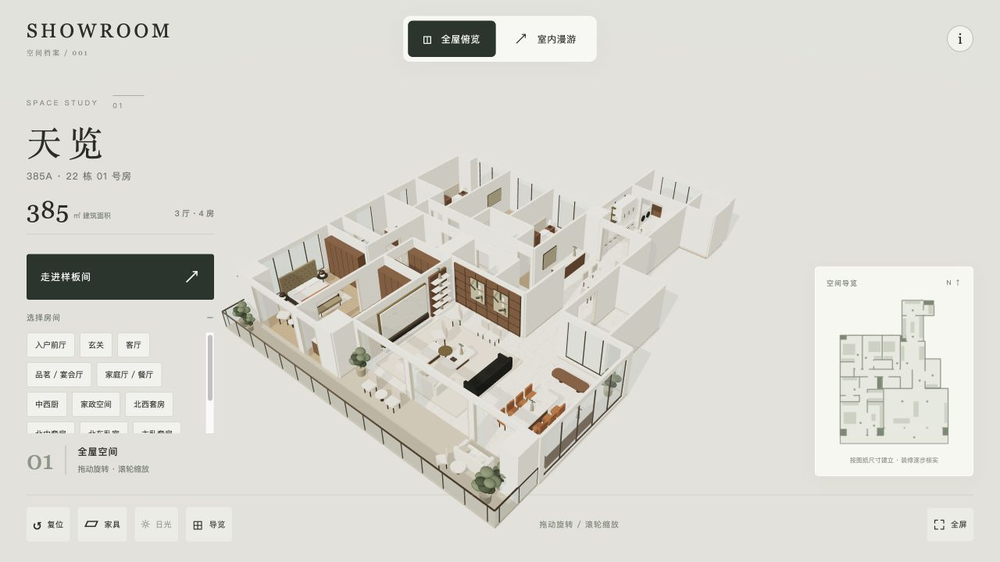
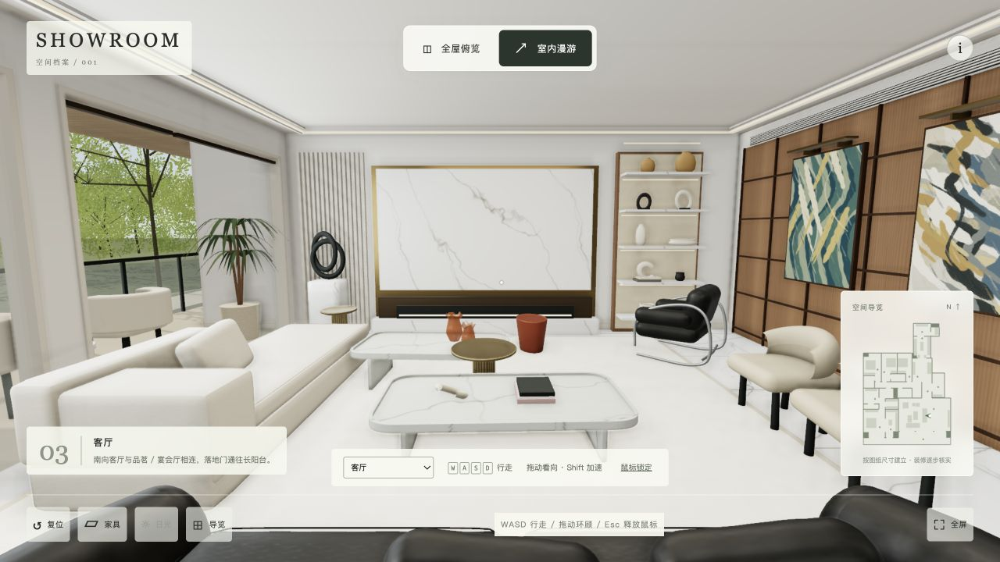
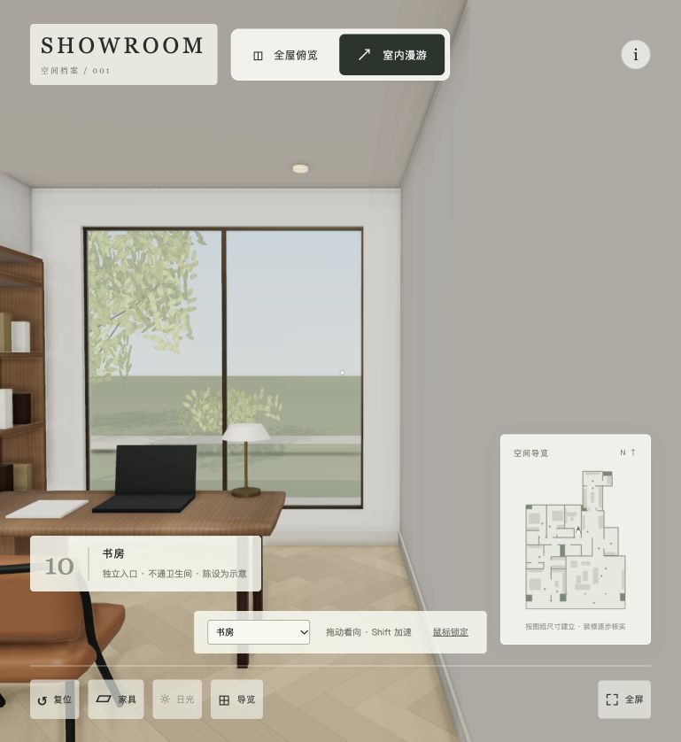

# 样板间三维漫游

一个可持续增加房型的 Three.js 浏览器项目。首个案例是 **蔚蓝卡地亚·天览 385A，22 栋 01 户型**：依据公开平面图建立空间，支持在浏览器里观察布局和漫游。

**[打开三维漫游](https://alainresearch.github.io/showroom-3d/)** · 无需登录







当前为 **0.3.1 现场用途修正版**：重做低矮黑皮沙发、奶白卧榻与托盘茶几，细化框线厨柜、厨电、水槽和水滴吊灯；改进灰金石纹、窗侧光、展示架与画作，并增加分层树冠和曲线水岸。北东房间依据用户实地参观确认改为独立书房（不通卫生间），书房家具暂作示意。仍属于近似还原。图纸标注建筑面积约 385㎡（含公摊），不等于模型地板面积。净高暂定 3.1 m；客餐厅、厨房、主卧、主卫已参考公开照片，次卧等仍含示意陈设，尚未完成全屋逐项验证。完整证据边界见 [证据与还原程度](docs/EVIDENCE_AND_FIDELITY.md)。

已核看 **14 张主要照片，另有 3 张同图出处版本**。现场照片与宣传合成图分别登记，照片不随公开代码分发。查看 [参考清单](showrooms/tianlan-385a-01/reference-manifest.json) 与 [逐房间还原笔记](showrooms/tianlan-385a-01/sources.md)。

支持第一人称行走、墙体和家具碰撞、俯览、小地图、房间切换、家具显隐、光线演示、触屏摇杆。6 项自动检查覆盖几何数值、14 处安全传送点及有无家具时从入口到全部房间的连续步行路径。渲染与主要控件另做浏览器人工检查。

详细变更见 [版本记录](docs/CHANGELOG.md)。

## 本地运行

需要 Node.js 20 或以上及 Python 3，构建不需要安装 npm 依赖。

```sh
npm run build
npm run serve
```

打开 <http://127.0.0.1:4173>。修改源文件后重新构建并刷新页面；静态站点部署使用 `dist/` 内容。

```sh
npm test
```

## 项目结构

```text
web/                         共享浏览器界面、交互与 Three.js vendor
showrooms/<slug>/model.js     单个房型的空间、家具和碰撞模型
showrooms/<slug>/metadata.json 公开标题、证据来源和假设
showrooms/<slug>/materials.js 原创程序材质（可选）
showrooms/<slug>/exterior.js  窗外布景（可选）
showrooms/<slug>/sources.md   可公开的证据说明（如有）
docs/                        扩充方法与还原标准
scripts/build.mjs            零依赖静态构建
dist/                        构建产物，不提交
```

构建脚本复制 `web/` 及每个案例的 顶层公开 `.js` 模块与 `metadata.json`，生成 `showrooms.json` 案例清单。私人参考、原始照片与 Blender 工程不进入发布包。增加房型的方法见 [添加样板间](docs/ADDING_A_SHOWROOM.md)。

## 发布

`main` 保存源文件，`gh-pages` 保存已构建的静态页面。GitHub Pages 从 `gh-pages` 分支根目录发布。

更新时先在 `main` 完成 `npm test` 和 `npm run build`，再把 `dist/` 的内容同步到单独检出的 `gh-pages` 分支，保留 `.nojekyll`，正常提交并推送。不要直接在 `gh-pages` 修改模型源文件；主分支推送不会自动替你更新发布分支。

## 来源与权利

首案例参考 [公开文章及户型图](https://www.sohu.com/a/1007897925_121798391)。来源图像的著作权不等同于代码或模型的许可；公开可访问也不代表允许再分发。仓库保留 Three.js 的 MIT 声明；第三方照片、图纸、纹理及模型应分别确认权利并保留署名。本项目暂未为自身代码及模型添加统一许可。
